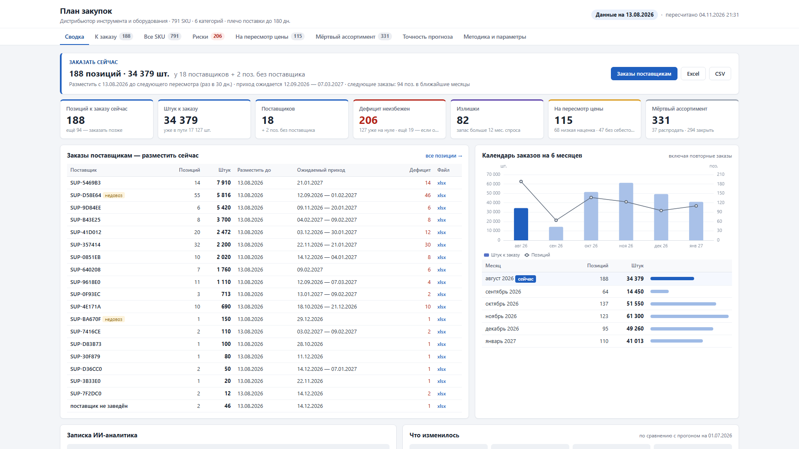

# ИИ-система планирования закупок

Что, сколько и когда заказывать у поставщиков импортного товара (инструмент, садовая техника, сантехника из Азии), когда товар едет 4–6 месяцев и решение приходится принимать под прогноз спроса, а не под текущие продажи.

Система читает выгрузку ERP (6 CSV), считает прогноз спроса с учётом сезонности, остатков, товара в пути, надёжности поставщиков и наценки и выдаёт:

- **дашборд** (GitHub Pages, по-русски): что заказать сейчас и сколько, у какого поставщика, когда следующий заказ, на сколько хватит запасов, где риск дефицита или излишка, что на пересмотр цены, что мёртвый ассортимент, насколько точен прогноз и что изменилось с прошлого прогона;
- **заказы поставщикам** — готовые списки с выгрузкой в Excel и CSV;
- **записку ИИ-аналитика** — короткий разбор по-русски и пояснения к самым рисковым позициям;
- **дайджест в Telegram** после каждого планового прогона;
- **скилл Claude Code `/zakupki`** — пересчитать и разобрать результат вопросами («почему по SKU-X 400 шт.?»).

Числа считает детерминированный Python. LLM получает уже посчитанные числа и только пишет текст — количества он не меняет.



## Как запустить локально

Нужен Python 3.12. Команды — для bash (Linux/macOS; на Windows — Git Bash). Python окружения лежит в `.venv/bin/python` (Linux/macOS) или `.venv/Scripts/python.exe` (Windows) — первая строка ниже кладёт нужный путь в `PY`:

```bash
python -m venv .venv
PY=.venv/bin/python; [ -x "$PY" ] || PY=.venv/Scripts/python.exe
$PY -m pip install -r requirements.txt
$PY -m procurement run --no-ai           # расчёт без ИИ, ~5 с
```

Дашборд — `site/index.html` (открыть в браузере). Другие режимы:

```bash
$PY -m procurement run                       # с запиской ИИ (ключ в .env)
$PY -m procurement run --notify              # + дайджест в Telegram
$PY -m procurement notify                    # только дайджест по уже посчитанному out/
$PY -m procurement run --as-of 2026-07-01    # на прошлую дату (данные обрезаются)
$PY -m procurement seed-history              # записать «прошлый» прогон для сравнения
$PY -m pytest -q                             # тесты
```

Новые данные — заменить CSV в `data/raw/` тем же форматом и перезапустить. Ключи для ИИ и Telegram — `cp .env.example .env` и вписать значения (см. [docs/setup.md](docs/setup.md)); без них всё остальное работает.

## Как устроено

```
data/raw/*.csv ──► data ──► demand ──► plan ──► out/plan.json ──┬─► site ──► site/ (Pages)
  (выгрузка ERP)   проверка  прогноз   решение                  ├─► ai ────► записка (DeepSeek)
                   и дата    спроса    по SKU                    ├─► history ► history/<дата>.json, разница с прошлым
                             supply ───┘                         ├─► notify ─► Telegram
                             плечо, в пути, надёжность           └─► backtest ► точность прогноза
```

| Модуль | Что делает |
|---|---|
| `procurement/config.py` | параметры из `config.toml` |
| `procurement/data.py` | чтение и проверка CSV, дата анализа, обрезка данных на прошлую дату |
| `procurement/demand.py` | прогноз спроса на 18 мес: сезонный профиль категории и SKU, уровень, тренд, учёт упущенного спроса (месяцы без остатка) |
| `procurement/supply.py` | плечо поставки по SKU/поставщику, товар в пути и опоздания, надёжность поставщика (доля привезённого), кратность партии |
| `procurement/plan.py` | решение по каждому SKU: заказать сейчас / позже / не нужно / пересмотр цены / мёртвый; количество с расшифровкой «почему столько»; заказы по поставщикам; календарь заказов |
| `procurement/backtest.py` | проверка прогноза на истории: модель против наивного «среднее за последние 12 мес» |
| `procurement/history.py` | история прогонов и что изменилось с прошлого |
| `procurement/ai.py` | записка ИИ-аналитика (единственный модуль, говорящий с LLM) |
| `procurement/site.py` | статический дашборд и выгрузки Excel/CSV |
| `procurement/notify.py` | дайджест в Telegram |
| `procurement/__main__.py` | командная строка `python -m procurement` |

**Политика заказа** — «заказ до уровня» с пересмотром раз в месяц. Заказ, размещённый сегодня, придёт через плечо поставки и должен закрыть спрос ещё на период покрытия:

```
заказ = прогноз на период покрытия + страховой запас − остаток к приходу − что ещё придёт в этот период
        × поправка на недовоз поставщика, округление до партии
```

Каждое слагаемое сохраняется в `explain` у SKU и показывается на дашборде. Товар с наценкой ниже порога или без себестоимости в заказ не попадает — он идёт в список на пересмотр цены; без продаж 12 месяцев — в мёртвый ассортимент.

Что важно в деталях (решения — [docs/adr/](docs/adr/README.md)):

- **Страховой запас по сезону окна (D07).** √(покрытие² + плечо²), каждая часть — по разбросу продаж, отмасштабированному сезоном своего окна, не больше 2 мес. спроса периода покрытия. Обогреватель с приходом в феврале не получает октябрьский страховой: заказ переносится на дату, к которой он придёт перед сезоном.
- **Партия (D08).** Медиана приходов SKU — привычный объём, а не минимальный заказ поставщика: до неё округляем, только если это добавляет не больше месяца спроса.
- **Надёжность поставщика (D09).** Заказ, к которому не сопоставлен ни один приход, — «нет данных», а не «недовоз 100%».
- **Заказ сейчас — до следующего пересмотра (D11).** Если по расчёту следующий заказ понадобится раньше, чем через 30 дн. (сезон набирает ход), он входит в текущий.
- **Мёртвый ассортимент: 331 + 47 = 378.** В README выгрузки «пустая наценка = 378 мёртвых SKU». У 47 из них продажи за 12 мес. были (1–22 шт.), но себестоимость не проставлена: они не мёртвые, а идут «на пересмотр» с флагом «нет себестоимости» (D02). Мёртвых по продажам — 331.

Результат прогона: `out/plan.json` (план), `out/diff.json` (изменения), `out/backtest.json` (точность), `out/note.json` (записка ИИ), `history/<дата анализа>.json` (коммитится; повторный прогон на тех же данных перезаписывает свою дату), `site/` (дашборд).

## Параметры

Все бизнес-параметры — в [`config.toml`](config.toml), у каждого комментарий. Главные:

| Параметр | По умолчанию | Смысл |
|---|---|---|
| `min_markup_pct` | 25 | минимальная наценка к себестоимости за 12 мес, %; ниже — на пересмотр цены |
| `default_cover_days` | 60 | период покрытия, дн., если в ERP не задан |
| `review_period_days` | 30 | как часто пересматривается план, дн. |
| `service_level` | A 0,95 · B 0,90 · C 0,80 | уровень сервиса по ABC для страхового запаса |
| `safety_cap_months` | 2 | потолок страхового запаса, мес. спроса периода покрытия |
| `lot_max_overage_months` | 1 | до типичной партии округляем, если это добавляет не больше стольких мес. спроса |
| `trend_damping` | 0,5 | затухание тренда (тренд^N), выбрано по бэктесту |
| `lead_default_days` | 123 | плечо, если нет истории ни по SKU, ни по поставщику |
| `excess_cover_months` | 12 | излишек: запаса больше чем на столько месяцев |
| `dead_months` | 12 | мёртвый ассортимент: нет продаж столько месяцев |
| `reliability_max_uplift` | 1,2 | потолок поправки на недовоз поставщика |
| `change_threshold_pct` | 20 | порог «количество заметно изменилось» при сравнении прогонов |
| `as_of` | — | дата анализа вручную; по умолчанию — по данным |

Скилл `/zakupki` умеет поменять параметр, пересчитать в отдельную папку и показать разницу KPI.

## Точность прогноза

Бэктест: модель учится на данных до среза (дата анализа − 12 мес.) и прогнозирует 12 мес., которые сверяются с фактом; ориентир — «среднее за последние 12 мес.» по каждому SKU. Главная метрика — WAPE по парам «SKU × месяц» (заказ решается по SKU). Сравнение честное к наличию (D10): прогноз продаж месяца = min(прогноз спроса; остаток на 1-е + приходы), так месяц без товара не считается ошибкой; продажи новинок, заведённых после среза, не прогнозирует никто — они в оценку не входят. На текущих данных: WAPE по SKU — 66% у модели против 86% у наивного; модель точнее в 4 категориях из 6. В двух (зернодробилки, смесители) наивный не хуже — позиции к заказу оттуда помечены «прогноз категории не точнее наивного — проверить».

## Регулярный запуск

GitHub Actions ([`.github/workflows/plan.yml`](.github/workflows/plan.yml)) пересчитывает план:

- каждый день в 00:00 UTC (07:00 по Новосибирску); чтобы GitHub не выключил расписание через 60 дней без коммитов, раз в 50 дней job делает пустой коммит;
- при пуше новых CSV в `data/raw/`;
- по кнопке **Actions → «План закупок» → Run workflow**.

Прогон — три job по очереди: `plan` считает план, коммитит `history/` (с `[skip ci]`, только если история изменилась) и собирает сайт; `deploy` публикует дашборд на GitHub Pages; `notify` после публикации шлёт дайджест в Telegram (`python -m procurement notify`: KPI, топ-5 к заказу, новые риски, ссылка на уже обновлённый дашборд). Время «пересчитано» — по Новосибирску. Права у каждого job минимальные, ключ DeepSeek есть только у расчёта, секреты Telegram — только у дайджеста. Секреты и включение Pages — [docs/setup.md](docs/setup.md).

## ИИ-слой

- Модель — DeepSeek (`deepseek-chat`) через OpenAI-совместимый API, библиотека `requests`; ключ `DEEPSEEK_API_KEY` из окружения или `.env`.
- На вход — компактная сводка прогона (≈ 6 тыс. токенов): KPI, крупнейшие заказы, 15 самых рисковых SKU с расшифровкой «почему столько», изменения с прошлого прогона, календарь, просрочки, надёжность поставщиков, точность прогноза.
- Промпт — [`prompts/analyst.md`](prompts/analyst.md): роль аналитика по закупкам, правило «только числа из входа, ничего не досчитывать», ответ строго JSON — записка из четырёх разделов («Главное», «Что изменилось с прошлого прогона», «Риски», «Что сделать сегодня») и пояснения к рисковым SKU.
- SKU, которых нет во входе, вычищаются из ответа. Ответ кешируется по хешу входа — повторный прогон на тех же данных API не вызывает.
- Нет ключа, ошибка API или таймаут (60 с) — дашборд собирается без записки, на её месте причина.

## Ограничения данных

- Денег в данных нет — только наценка в процентах и дециль цены внутри категории, поэтому нет денежной оценки заказа и бюджета.
- Продажи — суммарно по всем каналам; разложить спрос по каналам нельзя.
- Вес есть только у 7 SKU из 791, объёма нет вовсе — расчёта контейнеров нет, вес показывается там, где есть.
- Остатки — только с 2024-01; упущенный спрос (месяцы с нулевым остатком) до этого не распознаётся.
- У части SKU нет истории приходов — плечо для них оценочное (по поставщику или значение по умолчанию), это помечено.
- Последний месяц выгрузки неполный — в расчёт средних не берётся; дата анализа — день выгрузки этого месяца.
- Наценка — к закупочной цене, без логистики, растаможки и хранения.
- Данные обезличены: коды SKU, поставщиков и заказов — псевдонимы, названий нет.
- Вход — CSV-выгрузка; прямого подключения к ERP нет.
